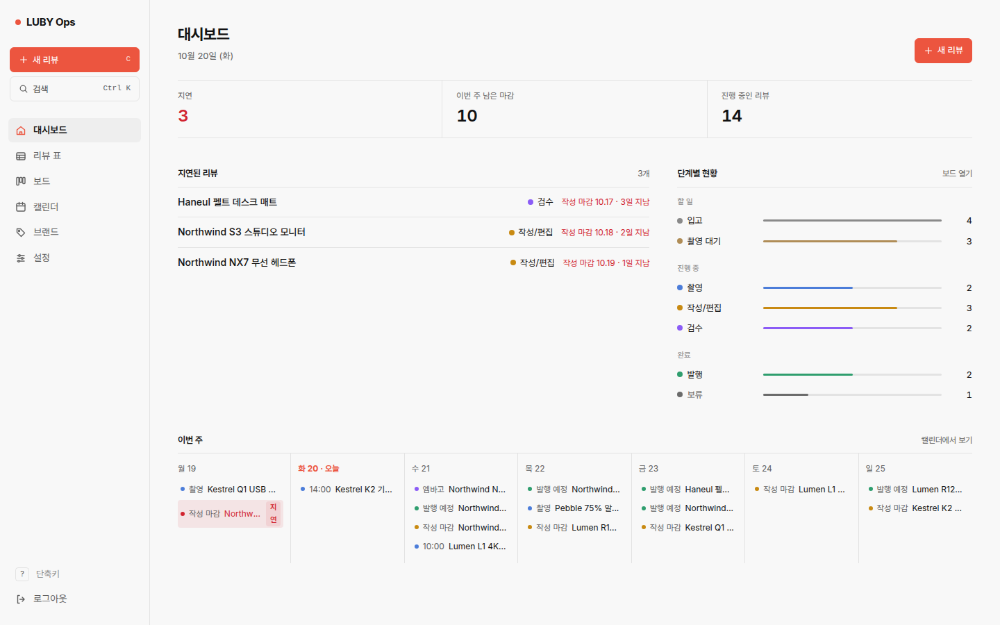
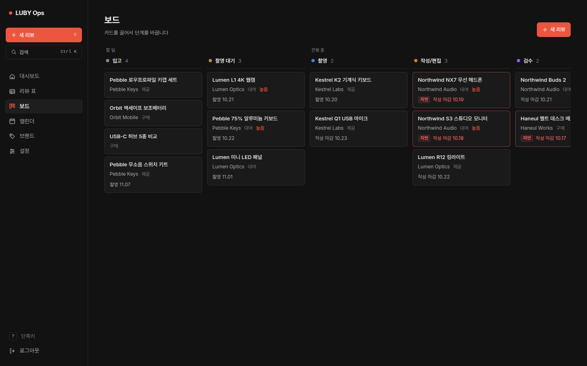
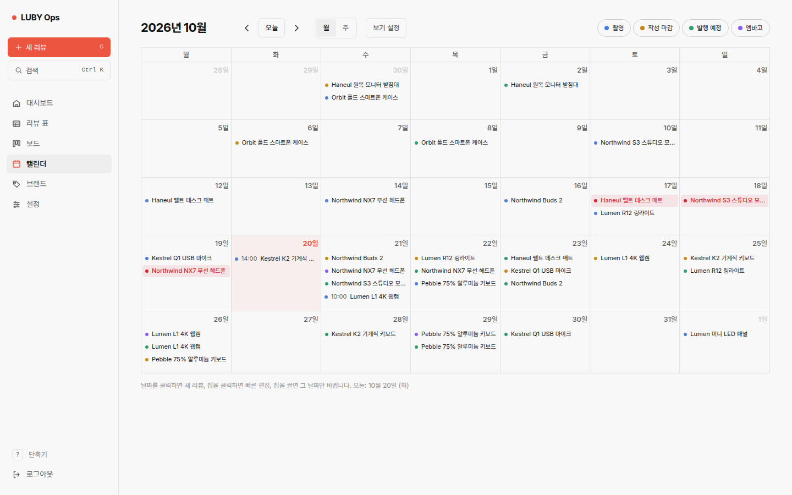
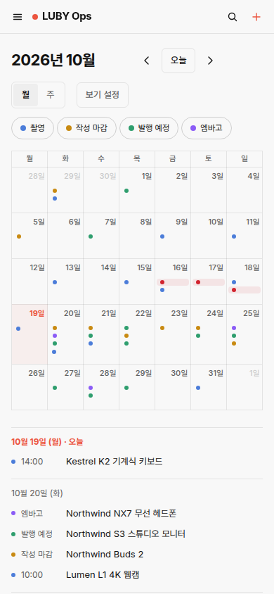
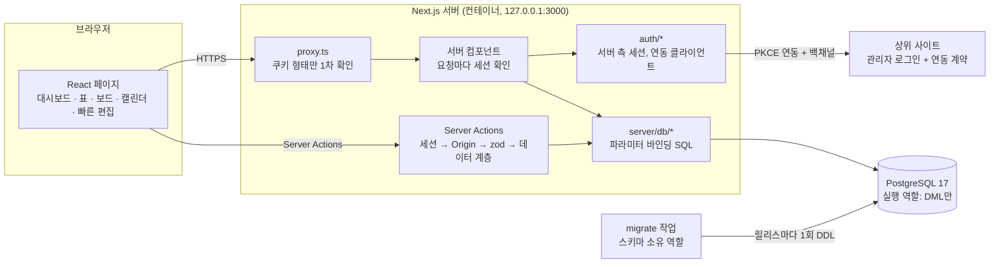

# Review Ops

[English](README.md)

장비 리뷰어를 위한 1인용 업무 관리 앱입니다. 리뷰 제품이 들어온 뒤(입고) 촬영·작성·검수를 거쳐 발행되기까지
모든 단계와 마감일을 한곳에서 관리합니다. Next.js 16 · React 19 · TypeScript strict · PostgreSQL 17
(ORM 없이 SQL 직접 작성).



| 보드 (다크) | 캘린더 | 모바일 |
| --- | --- | --- |
|  |  |  |

스크린샷의 브랜드와 제품은 모두 **가상의 데모 데이터**입니다. 스크린샷은 제가 실제로 쓰는 빌드에서 찍어서 앱 이름이
"LUBY Ops"로 보이고, 이 공개 저장소에서는 일반 이름 "Review Ops"를 씁니다.

## 해결하려는 문제

저는 키보드·마우스·헤드셋·모니터 같은 컴퓨터 주변기기를 리뷰합니다. 제품은 대여·제공·구매로 들어오고, 제품마다
촬영일, 작성 마감, 발행 예정일이 따로 있고 엠바고가 붙기도 합니다. 대여품은 돌려줘야 합니다. 리뷰가 10~15개씩
동시에 돌아가면 스프레드시트와 캘린더 앱으로는 "지금 어느 단계인지"와 "언제 무엇이 마감인지"가 따로 놀았습니다.
지연된 항목이 눈에 띄지 않았고, 한쪽에서 날짜를 바꿔도 다른 쪽은 그대로였고, 엠바고를 놓치기 쉬웠습니다.

Review Ops는 리뷰 하나를 레코드 하나로 두고 대시보드·표·보드·캘린더를 모두 거기서 만들어 냅니다.

## 기능 (1단계: 리뷰 일정)

- **대시보드**: 지연된 리뷰, 단계별 현황, 이번 주 일정
- **리뷰 표**: 단계·분류·브랜드·기간·검색 필터, 열 정렬, 보관함. 필터 상태는 URL에 저장
- **보드**: 단계별 칸반. 카드를 끌면 단계가 바뀌고 이력이 남음
- **캘린더**: 월/주 보기. 촬영·작성 마감·발행 예정·엠바고 중 보일 항목을 골라 색 칩으로 표시, 칩을 끌면 그 날짜
  하나만 바뀜, 주 보기는 촬영 시간대 그리드, 지연은 빨간색
- **빠른 편집**: 칩·카드·대시보드 항목을 누르면 페이지 이동 없이 옆 패널(모바일은 아래 시트)에서 자주 쓰는 필드를
  수정. 다른 곳에서 바뀐 리뷰는 덮어쓰지 않음
- **리뷰 상세**: 모든 필드, 단계 이력, 체크리스트, 마크다운 메모, 엠바고 경고
- **빠른 만들기**(`C` 또는 날짜 클릭): 대여/제공/구매 템플릿이 단계·마감일·체크리스트를 채움
- **명령 팔레트**(`Ctrl/⌘ K`): 리뷰로 이동, 새 리뷰, 날짜로 이동(`11/3`, `내일`, `+7`)
- **브랜드**(삭제 대신 보관), **설정**(주 시작 요일, 주말, 24시간제, 테마, 단계, 템플릿). 라이트/다크, 390px 모바일

## 구조



데이터 모델(ER 다이어그램)은 [README.md](README.md#data-model)에 있습니다. 핵심 테이블은 `workflow_stages`,
`brands`, `reviews`, `review_stage_history`, `review_checklist_items`, `templates`, `user_settings`,
`auth_sessions`입니다.

## 설계 결정과 이유

- **ORM 없이 `pg`로 SQL 직접 작성**: 중요한 규칙이 DB에 있습니다. 날짜 순서·열거형 CHECK 제약, 리뷰에 나중에 생길
  *작업(task)* 단계를 줄 수 없게 하는 복합 외래키, 단계 변경과 같은 문장에서 이력을 남기는 트리거, 날짜 열별 부분
  인덱스, 필드마다 `UNION ALL` 한 갈래인 캘린더 쿼리. SQL을 직접 써야 이것들을 그대로 검토할 수 있습니다. zod는
  친절한 오류 메시지용이고 최종 판단은 DB가 합니다.
- **DML만 가능한 실행 역할**: 앱은 select/insert/update/delete만 되는 역할로 접속합니다. DDL 불가, 고정 분류는
  읽기 전용, 마이그레이션 기록 접근 불가. 앱에 버그나 인젝션이 있어도 스키마는 못 바꿉니다. 통합 테스트도 이 역할로
  돌려서 앱이 그 이상 필요 없음을 증명합니다.
- **마이그레이션은 관문, 시작 시 실행 안 함**: 스키마 소유 자격 증명이 있는 유일한 곳인 일회성 `migrate` 작업이
  체크섬 검증된 마이그레이션을 적용하고 DML 권한을 다시 줍니다. 실패하면 릴리스를 멈추고 돌고 있는 앱은 그대로입니다.
- **서버 측 세션**: 쿠키는 256비트 무작위 값이고 DB에는 SHA-256만 저장합니다. 로그아웃하면 행이 지워져 복사한
  쿠키도 바로 죽습니다. 자체 검증형(JWT/HMAC) 쿠키는 쓰지 않습니다.
- **상위 사이트 관리자 로그인 연동 + PKCE**: 이미 쓰는 웹사이트 관리자 로그인을 그대로 씁니다. 비밀번호를 하나 더
  관리하지 않기 위해서입니다. 인가 코드 + PKCE S256 형태, 로그인 CSRF를 막는 브라우저 바인딩 쿠키, 1회용 60초 코드,
  관리자 세션을 다시 확인하는 백채널로 사이트에서 로그아웃하면 정해진 시간 안에 Ops 세션도 끝납니다. 사이트의 일반
  회원 로그인으로는 들어올 수 없습니다. 사이트 쪽은 [docs/AUTH.md](docs/AUTH.md)에 **프로토콜 계약**으로만 적었고,
  저장소에는 테스트용 가짜 구현만 있습니다.
- **낙관적 동시성 제어**: 폼은 불러올 때의 `updated_at`을 들고 있고, 그 사이 다른 탭·캘린더 드래그·보드 이동으로
  바뀌었으면 저장을 거절합니다. 단계 이동은 `select … for update`로 행을 잠가 동시 드래그를 줄 세웁니다.
- **KST 날짜 처리**: 날짜만 있는 값은 서울 기준 `date`, 시각은 `timestamptz`(UTC). 한국은 서머타임이 없어
  +09:00 고정으로 계산합니다. 지연은 마감일 KST 23:59:59가 지나야 시작합니다.
- **소프트 삭제**: 브랜드·리뷰·단계·템플릿은 `archived_at`으로 보관만 합니다.

## 실행

Node.js 24, PostgreSQL 17이 필요합니다. 자세한 명령은 [README.md](README.md#running-locally)를 보세요.

```bash
npm ci
cp .env.example .env.local
npm run db:migrate -- --grant ops_app
npm run hash-password
npm run db:seed     # 선택: 가상 데모 데이터
npm run dev
```

## 테스트

```bash
npm run lint && npm run typecheck
npm run test:unit
npm run test:integration     # 실제 PostgreSQL, 매번 새 DB, 마이그레이션 0부터, DML 전용 역할로 접속
npm run build && npm run test:e2e
```

통합·E2E 테스트는 **버려도 되는** 서버의 `TEST_DATABASE_URL`만 씁니다(루프백 55433 포트가 아니면 거부, 자기가
만든 DB만 지움). CI는 lint, typecheck, 단위, 빌드, `postgres:17` 서비스 컨테이너로 통합 테스트, 러너의 Chrome으로
브라우저 E2E, gitleaks를 돌립니다.

## 로드맵

- **2단계**: 작업·메모(같은 단계/템플릿 모델 사용), 대시보드 통합
- **3단계**: 브랜드 CRM: 담당자, 대여·반납, 계약(계약의 엠바고가 리뷰 엠바고를 채움)
- **4단계**: 수익: 협찬·제휴 수익, 월간 리포트
- **아이폰 위젯**: 읽기 전용, 기기별로 취소 가능한 토큰. 계약만 [docs/WIDGET-API.md](docs/WIDGET-API.md)에 있고
  구현은 아직 없음

## 한계

- 1인용입니다. 여러 사용자·권한·공유는 없습니다.
- 운영 로그인은 연동 계약을 구현한 상위 사이트가 있어야 합니다. 없으면 로컬 `demo-password` 모드만 됩니다.
- 컨테이너 이미지는 Dockerfile·Compose로 정의만 했고 이 저장소 CI에서는 빌드하지 않습니다.
- 발행된 글 자동 동기화는 아직 없습니다.
- UI는 한국어만 있습니다.

## 제 역할

요구사항, 업무 흐름, 데이터 모델, 보안 결정은 제가 정했고, 제 리뷰 작업에 이 앱을 실제로 운영하며 쓰고 있습니다.
구현은 AI 코딩 에이전트가 했고, 별도의 리뷰 모델과 이 저장소의 자동 테스트로 검증했습니다.

## 라이선스

MIT ([LICENSE](LICENSE)). Inter·Pretendard 글꼴은 SIL Open Font License 1.1로 포함되어 있습니다.
