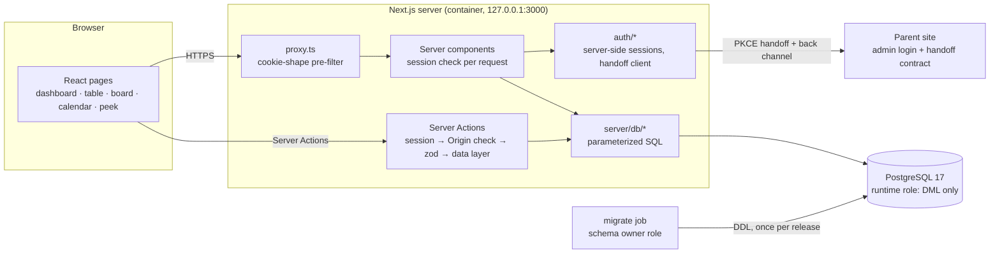
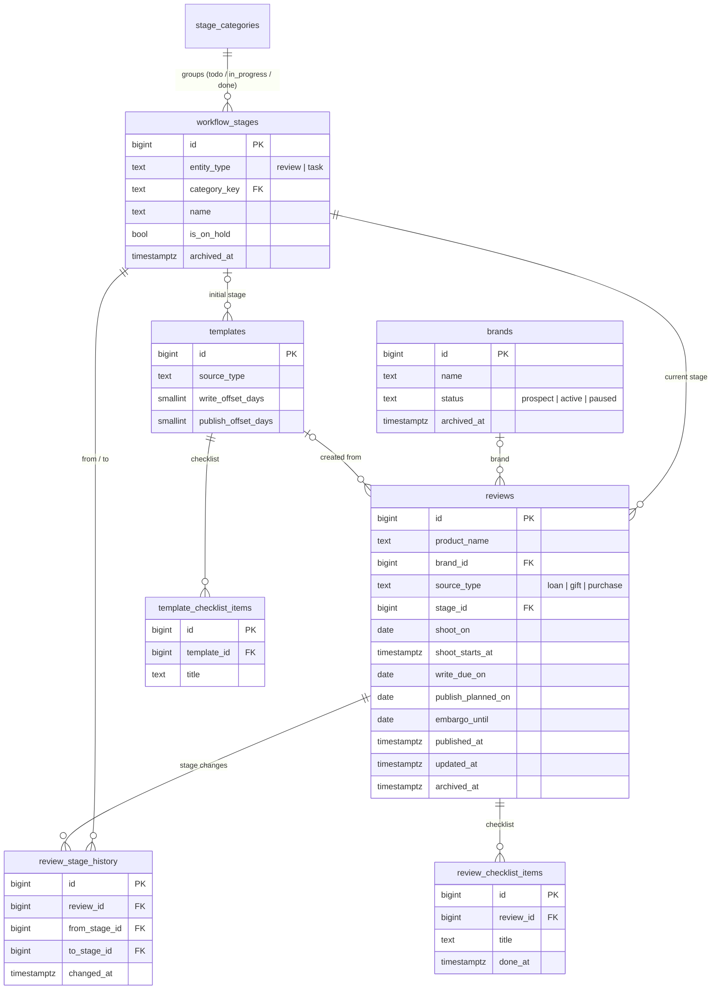

# Review Ops

[한국어](README.ko.md) · [](https://github.com/lubydubybubu/review-ops-dashboard/actions/workflows/ci.yml)

A single-owner operations app for a gear reviewer: every review product from arrival through shooting,
writing, review and publishing, with deadlines on a calendar. Next.js 16 · React 19 · strict TypeScript ·
PostgreSQL 17 (raw SQL, no ORM).


| Board (dark) | Calendar | Mobile |
| --- | --- | --- |
|  |  |  |

All brands and products in the screenshots are **fictional demo seed data**. The screenshots come from my
own build, where the app is titled "LUBY Ops"; this public repository uses the generic name "Review Ops".

## The problem

I review computer peripherals (keyboards, mice, headsets, monitors). Products arrive as loans, gifts or
purchases, and each one has its own shooting day, writing deadline, planned publish date and sometimes an
embargo. Loans have to go back. With 10–15 reviews in flight, spreadsheets and calendar apps lost the
connection between *where a review is* (stage) and *what is due when* (dates): overdue items did not stand
out, moving a date in one place did not move it in the other, and embargoes were easy to miss.

Review Ops keeps one record per review and derives every view from it: dashboard, table, stage board
and calendar.

## Features (phase 1: review schedule)

- **Dashboard**: overdue reviews, counts per stage, this week at a glance.
- **Review table**: filters for stage, category, brand, date range and text; column sorting; archive.
  Filter state lives in the URL.
- **Board**: kanban per stage; dragging a card changes the stage and writes stage history.
- **Calendar**: month/week; pick which date fields appear as colored chips (shoot, write-by, planned
  publish, embargo); dragging a chip changes exactly that one date; timed shoots on a week time grid;
  overdue in red.
- **Quick edit ("peek")**: click a chip, card or dashboard row to edit the most-used fields in a side panel
  (bottom sheet on phones) without leaving the page. A save is refused if the review changed elsewhere.
- **Review detail**: all fields, stage history, checklist, markdown notes, embargo warning.
- **Quick create** (`C`, or click a day) with templates per source (loan / gift / purchase) that preset
  stage, deadline offsets and checklist.
- **Command palette** (`Ctrl/⌘ K`): jump to a review, create one, go to a date (`11/3`, `내일`, `+7`).
- **Brands** (archive instead of delete) and **settings** (week start, weekends, 24h clock, theme, stages,
  templates). Light/dark, works at 390 px, Korean UI.

## Architecture



Code layout:

```
db/migrations/NNN-*.sql   versioned schema (applied by src/server/db/migrate.ts)
src/lib/domain/*          pure rules: KST dates, overdue, template offsets, stage-move plan, palette dates
src/lib/validation.ts     zod schemas shared by actions and tests
src/server/db/*           typed data layer: parameterized SQL only
src/server/actions/*      'use server': session → Origin → zod → data layer → typed result
src/server/auth/*         server-side sessions, handoff client (PKCE, back channel), rate limits
src/app/(app)/*           pages: dashboard, reviews, reviews/[id], board, calendar, brands, settings
tests/unit, tests/integration, e2e/run.ts
```

### Data model



Plus `user_settings` (single row), `auth_login_attempts`, `auth_sessions` and the runner's
`schema_migrations` ledger (filename, checksum, applied_at).

## Design decisions and why

- **Raw SQL with `pg`, no ORM.** The interesting rules live in the database: CHECK constraints for date
  order and enum-like columns, composite foreign keys `(stage_id, stage_entity) → workflow_stages(id,
  entity_type)` so a review can never get a future *task* stage, a trigger that writes stage history in the
  same statement as the stage change, partial indexes per calendar date column, one `UNION ALL` branch per
  field in the calendar query. Writing that SQL directly keeps it reviewable; zod mirrors the constraints
  only for friendly messages, and the database has the last word.
- **DML-only runtime role.** The app connects as a role that can select/insert/update/delete and nothing
  else: no DDL, read-only fixed categories, no access to the migration ledger. A bug or injection in the app
  cannot change the schema. Integration tests run as such a role, which proves the app never needs more.
- **Migrations as a gate, never at startup.** A one-shot `migrate` job (the only place the schema-owner
  credential exists) applies checksummed migrations and re-grants DML. If it fails, the release stops and the
  running app is untouched. Startup never migrates and never seeds.
- **Server-side sessions.** The cookie is an opaque 256-bit value; the database keeps only its SHA-256.
  Logout deletes the row, so a copied cookie dies immediately. No self-validating (JWT/HMAC) cookies.
- **Sign-in handoff from the parent site's admin login, with PKCE.** I already log in to my website's admin;
  a second password would be one more secret to manage. Ops gets a one-time, browser-bound proof of that
  admin session: an authorization-code + PKCE S256 shape for one confidential client, a binding cookie
  against login CSRF, one-use 60 s codes, and a back channel that re-checks the admin session so a site
  logout ends the Ops session within a bounded window. Member logins of the site never grant access.
  The site side is described as a **protocol contract** in [docs/AUTH.md](docs/AUTH.md); the repository ships
  a synthetic implementation for tests, not the real site's code.
- **Optimistic concurrency.** Forms carry the `updated_at` they were loaded with; a save is refused as stale
  if the row changed since (another tab, a calendar drag, a board move). Stage moves also lock the row
  (`select … for update`) so concurrent drags serialize.
- **KST date handling.** Date-only fields are `date` values meaning a Seoul calendar day; instants are
  `timestamptz` (UTC). Korea has no DST, so the offset is a fixed +09:00 and day arithmetic is done in UTC
  without drift. "Overdue" starts after 23:59:59 KST of the due day. FullCalendar runs in UTC mode with KST
  wall-clock values so only its MIT standard plugins are needed.
- **Soft delete.** Brands, reviews, stages and templates are archived (`archived_at`), never hard-deleted
  while referenced.

## Running locally

Requires Node.js 24 and PostgreSQL 17.

```bash
npm ci
cp .env.example .env.local
```

1. Create a schema-owner role and a DML-only app role and a database (see
   [db/bootstrap/001-roles-and-database.sql](db/bootstrap/001-roles-and-database.sql)).
2. Fill `DATABASE_URL` (app role) and `MIGRATION_DATABASE_URL` (owner role) in `.env.local`, then
   ```bash
   npm run db:migrate -- --grant ops_app
   npm run hash-password        # prompts on the TTY, prints OPS_PASSWORD_HASH
   npm run db:seed              # optional fictional demo data (empty DB only)
   npm run dev
   ```
   Local demo sign-in uses `OPS_AUTH_MODE=demo-password`; it is refused when `OPS_DEPLOYMENT=production`.
   With `OPS_AUTH_MODE` unset, sign-in is disabled (fail closed).

Deployment (container bound to 127.0.0.1, migration gate, backups, rollback):
[docs/DEPLOYMENT.md](docs/DEPLOYMENT.md). Future widget API contract: [docs/WIDGET-API.md](docs/WIDGET-API.md).

## Tests

```bash
npm run lint && npm run typecheck
npm run test:unit            # KST overdue boundaries, template dates, zod, stage moves, auth config, handoff client
npm run test:integration     # real PostgreSQL: fresh DB per run, migrations from zero, queries as a DML-only role
npm run build && npm run test:e2e   # system Chrome over HTTPS with real cookie attributes
```

Integration and E2E use `TEST_DATABASE_URL`, the superuser URL of a **throw-away** server. The harness
refuses anything that is not loopback on port 55433 (override with `TEST_DB_ALLOWED_PORT`) and drops only
databases it generated itself. E2E needs `CHROME_PATH` (default `/usr/bin/google-chrome`) and `openssl`; it
runs `next start` behind a local TLS proxy on RFC 6761 `.test` hostnames against the synthetic parent site and
checks sign-in, replay/CSRF refusal, revocation, board/calendar drag, quick edit, palette and shortcuts.

CI ([.github/workflows/ci.yml](.github/workflows/ci.yml)) runs lint, typecheck, unit, build, integration
against a `postgres:17` service container, the browser E2E with the runner's Chrome, and gitleaks.

## Roadmap

- **Phase 2**: tasks and notes on the same stage/template model (`entity_type = 'task'` is already allowed),
  dashboard integration.
- **Phase 3**: brand CRM: contacts, loans and returns, contracts (contract embargo feeds the review's
  embargo).
- **Phase 4**: revenue: sponsorship and affiliate entries, monthly report.
- **iPhone widget**: read-only, per-device revocable token, contract drafted in
  [docs/WIDGET-API.md](docs/WIDGET-API.md); nothing implemented yet.

## Limitations

- Single owner by design: no multi-user roles or sharing.
- Production sign-in needs a parent site that implements the handoff contract; without one, only the
  local `demo-password` mode works (not for production).
- The container image is described (Dockerfile, Compose) but not built or run in this repository's CI.
- No post sync from the published site yet; publish dates are entered by hand.
- Korean-only UI.

## My role

I defined the requirements, the workflow, the data model and the security decisions, and I run this app in
production for my own review work. The implementation was done with AI coding agents and verified by an
independent reviewer model plus the automated tests in this repository.

## License

MIT, see [LICENSE](LICENSE). Inter and Pretendard fonts are bundled under the SIL Open Font License 1.1
(`src/app/fonts/*-OFL.txt`). UX patterns were informed by clean-room notes on calendar/database tools; no
third-party product code, assets or text are included.
